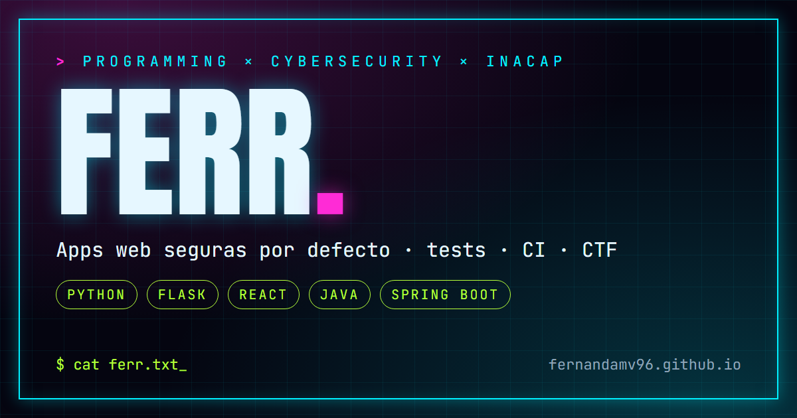

<div align="center">

# 🌐 ferr · portfolio

### Personal portfolio · Programming & Cybersecurity

[](https://github.com/Fernandamv96/Fernandamv96.github.io/actions/workflows/deploy.yml)
[](https://github.com/Fernandamv96/Fernandamv96.github.io/actions/workflows/ci.yml)
[](https://fernandamv96.github.io)
[](LICENSE)

</div>



## ¿Qué problema resuelve?

Reúne en una sola página quién soy, mi stack y mis proyectos principales, con estadísticas **reales y actualizadas** de GitHub. Está pensado para que reclutadores y docentes encuentren rápido el código y las demos.

## Características

- **Estética neón tech**: canvas negro, grid de circuito y acentos cian/magenta/lima, con tipografía display.
- **Estadísticas propias**: un GitHub Action genera `data.json` desde la API pública de GitHub en cada deploy y una vez al día. Si falla, el sitio muestra un texto alternativo sin números.
- **Sin dependencias en runtime**: HTML + CSS + JS vanilla, con fuentes servidas desde el propio sitio.
- **SEO y redes**: Open Graph y Twitter Card (imagen 1200×630), canonical, `sitemap.xml`, `robots.txt` y JSON-LD.
- **Seguridad**: CSP vía `<meta>` (sin scripts inline), `rel="noopener noreferrer"` en enlaces externos y gitleaks en pre-commit.
- **Accesibilidad**: enlace "Saltar al contenido", foco visible, contraste AA, landmarks, `prefers-reduced-motion` y tarjetas navegables por teclado.

## Proyectos: problema → solución → cómo usé cada tecnología

Cada proyecto se presenta como un caso breve: **el problema**, **la solución**, el stack y un desplegable *"Cómo lo construí"* con el rol concreto de cada tecnología y las decisiones de seguridad.

El contenido vive en `data/proyectos.json`. Para editarlo:

```bash
# 1. edita data/proyectos.json
npm run proyectos   # regenera las tarjetas dentro de index.html (HTML estático, sin JS)
```

El CI falla si `index.html` no está sincronizado con el JSON.

## Lighthouse

Medido en local (Lighthouse 12, perfil móvil):

| | Performance | Accessibility | Best Practices | SEO |
|---|:---:|:---:|:---:|:---:|
| Antes | 79 | 96 | 100 | 100 |
| Después | 99 | 100 | 100 | 100 |

El CI ejecuta Lighthouse CI en cada PR y **falla si alguna categoría baja de 95**.

## Cómo correrlo localmente

```bash
npm ci
npm run data      # genera data.json desde la API de GitHub (opcional)
npm start         # http://localhost:8000
npm run lint      # ESLint + html-validate
```

Sin `data.json`, la sección de estadísticas muestra el texto alternativo. Es el comportamiento esperado.

## Estructura

```text
├── index.html                 # página única
├── styles.css                 # design tokens + componentes
├── assets/
│   ├── js/main.js             # scroll suave + carga de data.json
│   ├── fonts/                 # Anton, Inter, JetBrains Mono (woff2, OFL)
│   ├── og-image.png           # 1200×630
│   └── favicon.svg
├── data/proyectos.json        # contenido de los casos de proyecto
├── scripts/build-data.mjs     # genera data.json en el build
├── scripts/build-proyectos.mjs # JSON → tarjetas en index.html
├── sitemap.xml · robots.txt
└── .github/workflows/         # deploy (Pages), CI (lint + Lighthouse), CodeQL
```

## Deploy

El workflow `deploy.yml` arma `_site/`, genera `data.json` y publica en GitHub Pages. Requiere **Settings → Pages → Source: GitHub Actions**.

## Qué aprendí

- Que las cifras escritas a mano envejecen rápido: los datos tienen que venir de una fuente.
- A medir antes de optimizar. La fuente bloqueante de Google y un elemento decorativo fijo explicaban casi toda la pérdida de rendimiento (CLS 0.227 → 0).
- A aplicar una CSP en un sitio estático y lo que eso implica (nada de scripts inline).
- Que la accesibilidad también es estructura: landmarks únicos, foco visible y enlaces que no se anidan.

## Licencia

Código bajo [MIT](LICENSE) © 2026 Fernanda (Fernandamv96). Fuentes bajo SIL OFL 1.1 ([detalle](assets/fonts/LICENSES.md)).
